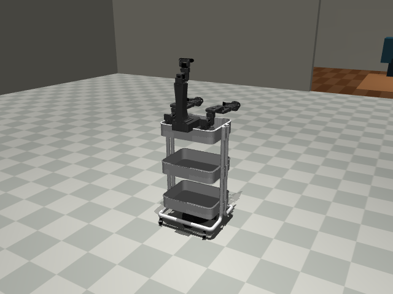

# XLeRobot ROS 2

ROS 2 Jazzy control, MuJoCo simulation and RGB-D mapping with wheel odometry for
[Victor Wang's XLeRobot](https://github.com/Vector-Wangel/XLeRobot), built on
[Aditya Kamath's LeKiwi ROS 2](https://github.com/adityakamath/lekiwi_ros2).



The Linux container runs physics, controllers, camera rendering, RTAB-Map,
Nav2 and the dashboard. The native MuJoCo viewer displays the same state.
Closing its window leaves simulation and cameras running.

## Run

Install [Pixi](https://pixi.sh), Git and Docker with Compose. On WSL, use
Docker Desktop with WSL integration enabled; the launcher selects the WSL GPU
configuration automatically. macOS acceleration uses lighter. Native Windows
WSLC remains an unvalidated alternative; see [Windows](docs/windows.md).

```bash
git clone --recurse-submodules https://github.com/cristidragomir97/XLeRobotROS.git
cd XLeRobotROS
pixi install --locked
pixi run doctor
pixi run up
pixi run sim
```

In another terminal:

```bash
pixi run view
```

The dashboard is at http://localhost:8889. `up` initializes the pinned source
modules and builds the shared rendering image and robot image. The first build
can take a while. The normal host environment contains no ROS packages.

Stop the simulation with Ctrl+C or `pixi run sim-stop`. Stop the container with
`pixi run down`; it saves the map and preserves volumes. Use `pixi run build`
after editing ROS source, or `pixi run images` after changing image dependencies.

The shared runner is pinned at `tools/multiros`. Host tasks and runtime setup
are described in `pixi.toml`.

## Arm configurations

```bash
pixi run sim standard
pixi run sim-stop
pixi run sim mod101
```

The Mod101 configuration has two 7DOF arms with PG grippers and the same base,
head, cameras and home world. Both configurations use the same controllers and
topic contract. See [Mod101 details](docs/mod101.md).

## Validation

WSL/Docker Desktop with Intel UHD 770 has passed live RGB-D, IMU, TF, mapping,
arm trajectory, controller ownership, base motion and watchdog checks. Earlier
Apple Silicon/lighter validation and current limits are recorded in
[validation](docs/validation.md). See [WSL performance](docs/wsl-performance.md)
for measured rendering costs and camera freshness.

## Documentation

- [Running, maps and launch options](docs/running.md)
- [Builds and checks](docs/development.md)
- [Container graphics](docs/container-rendering.md)
- [Windows](docs/windows.md)
- [ROS packages, controllers and topics](docs/ros-stack.md)
- [Mod101 arms](docs/mod101.md)
- [Robocore Viz profiles](src/robocore_viz/README.md)

## Credits

Victor Wang and the XLeRobot contributors supplied the robot design and assets.
Aditya Kamath supplied the LeKiwi ROS packages and STS hardware integration.
Their repositories remain pinned submodules with their history and licenses.
See [credits](docs/credits.md), [NOTICE](NOTICE) and [Apache-2.0](LICENSE).
