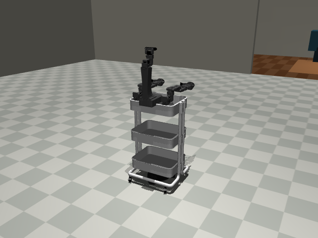
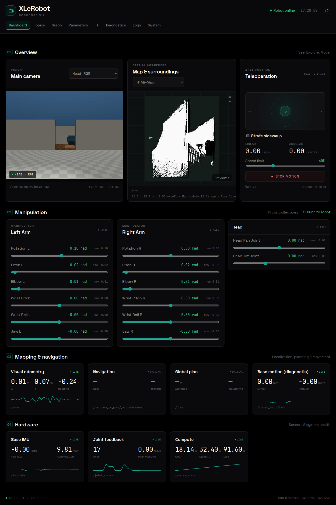

# XLeRobot · ROS 2

A Dockerized ROS 2 Jazzy stack for [Victor Wang's XLeRobot](https://github.com/Vector-Wangel/XLeRobot),
built on [Aditya Kamath's LeKiwi ROS 2](https://github.com/adityakamath/lekiwi_ros2).



[Get started](#get-started) · [Choose your arms](#choose-your-arms) · [Documentation](#documentation) · [Credits](#credits)

## What you get

- **MuJoCo simulation** with the full robot, white cart and furnished home.
- **ROS control** for the omni base, both arms and pan/tilt head.
- **RGB-D mapping and navigation** with RTAB-Map, Nav2, a depth camera and base IMU.
- **Browser controls** for driving, joints, camera feeds and the map.

## Get started

You'll need Docker Engine and Docker Compose. From the repository root:

```bash
./scripts/manage.sh start
./scripts/manage.sh sim
```

The first start builds the image and fetches the required upstream sources and world assets.
The simulation opens a MuJoCo window and starts mapping, navigation and both browser views.

| Open | What it's for |
|---|---|
| [localhost:8889](http://localhost:8889) | Dashboard: drive, arms, cameras and map |
| [localhost:8082](http://localhost:8082) | Live 3D simulation viewer |

Ctrl+C or closing the MuJoCo window stops the simulation and saves the map.
For a machine without a display:

```bash
./scripts/manage.sh sim headless:=true
```



## Choose your arms

| Configuration | Arms |
|---|---|
| `standard` | Original XLeRobot arms |
| `mod101` | Two Mod101 arms, 7DOF option, 140/140 mm links and PG grippers |

```bash
./scripts/manage.sh sim standard

# Stop before switching
./scripts/manage.sh sim-stop
./scripts/manage.sh sim mod101
```

Mod101's 7DOF option is six arm axes plus the gripper motor.
Each configuration gets its own map database and matching dashboard controls.
See [Mod101 mounting and clearance](docs/mod101.md) for the mechanical details.

## Everyday commands

| Command | Action |
|---|---|
| `./scripts/manage.sh teleop` | Keyboard drive; Shift+J/L strafes |
| `./scripts/manage.sh rviz` | Open RViz; use Nav2's goal tool to navigate |
| `./scripts/manage.sh sim-stop` | Stop the simulation, keep Docker running |
| `./scripts/manage.sh stop` | Stop the container too |
| `./scripts/manage.sh help` | All commands |

Maps live in `.runtime/` and survive container restarts.
Copy [.env.example](.env.example) to `.env` to change ports or the default arm configuration.

## Documentation

| Guide | What's inside |
|---|---|
| [Running the simulation](docs/running.md) | Headless mode, worlds, saved maps and localization |
| [ROS stack](docs/ros-stack.md) | Packages, controllers, topics and TF |
| [Mod101 arms](docs/mod101.md) | Mounting, joint names and collision clearance |
| [Dashboard profiles](src/robocore_viz/README.md) | Configure or reuse Robocore Viz |
| [Development](docs/development.md) | Builds, checks and container workflow |
| [Validation](docs/validation.md) | Tested behavior and simulation limits |

## Credits

Thanks to **Victor and Aditya** for sharing their work and making this possible.

- **[Victor Wang](https://github.com/Vector-Wangel)** — XLeRobot's robot design, meshes and original simulation.
- **[Aditya Kamath](https://github.com/adityakamath)** — LeKiwi ROS 2's control packages, omniwheel model and STS driver.

Victor's and Aditya's repositories are kept as pinned submodules, with their history and licenses intact.
This integration is [Apache-2.0](LICENSE); see [full credits](docs/credits.md) and [NOTICE](NOTICE) for upstream licenses and asset attribution.
