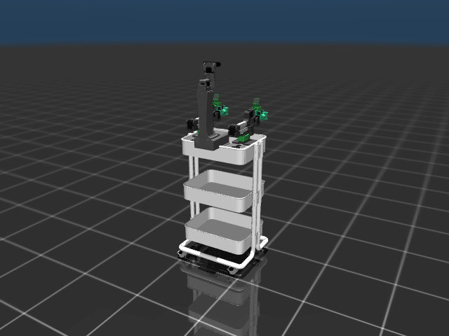

# Mod101 arms

[← Back to the README](../README.md)

Select the arms through `manage.sh`; each configuration has its own launch file:

```bash
./scripts/manage.sh sim standard    # original XLeRobot arms
./scripts/manage.sh sim-stop        # stop before switching configurations
./scripts/manage.sh sim mod101      # two Mod101 7DOF arms, 140/140 mm links
```

For a headless machine, append `headless:=true`.
Both launches retain the same home, native window, mapping, navigation
and browser defaults. Set `XLEROBOT_CONFIGURATION=mod101` in `.env` to make
`./scripts/manage.sh sim` select Mod101 by default; an explicit selector wins.
The `sim.launch.py` entry point remains compatible with the original setup.
Direct ROS launches are `sim_standard.launch.py` and `sim_mod101.launch.py`
in the `xlerobot_sim` package.

| Configuration | Arms | Upper/forearm links | Controlled joints |
|---|---|---|---|
| `standard` | Original XLeRobot/SO arms | Original source geometry | 17 total: 6 per arm, 2 head, 3 wheels |
| `mod101` | Two Mod101 arms, small shoulder/elbow mounts, PG grippers | 140 / 140 mm | 19 total: 7 per arm, 2 head, 3 wheels |

**Mod101's `7DOF` option means six arm axes plus the gripper motor.** It adds
wrist yaw compared with its `6DOF` configuration. Each PG motor drives two
passive rack sliders through the source mimic ratio; the sliders do not claim
additional control interfaces. The wrist-camera and base-housing meshes are
included. The head camera remains the simulated RGB-D sensor used by SLAM.

The Mod101 bases attach 135 mm forward of the inherited arm datums, beside the tower, with
−90° yaw so the arms point forward, replacing
the original arm and holder visuals. These are simulation mounting poses;
a physical adapter and its bolt pattern still need mechanical validation.
The Mod101 mount rises 3.1 mm above the inherited datum: the tower mounting
plate is 3 mm thick, with 0.1 mm mesh clearance. This removes the original base
housing overlap. Both pivots are now at chassis X=0, with their lateral positions unchanged.
The forward neutral pose has about 44 mm clearance at the moving shoulder
and 4 mm at the closest fixed housing/tower surfaces. Both rails remain 140 mm.

Inward arm poses can still hit the tower. The standard trajectory controllers
are not collision-aware, and simulation self-collisions remain disabled.
Shorter shoulder rails do not make the complete joint ranges safe. See the
[triangle-mesh measurements and sampled poses](mod101-tower-clearance.json).
Check the neutral pose or repeat the finite range study with:

```bash
./scripts/manage.sh test --clearance
./scripts/manage.sh test --clearance --sweep --output /workspace/xlerobot/.runtime/tower-clearance.json
```

The sweep samples 245 base/shoulder/elbow poses and 300 deterministic whole-arm
and head poses per arm. It reports intersecting configurations; it does not
certify trajectories or check arm-to-arm/cart collisions.

The authored description is
[`xlerobot_mod101.urdf.xacro`](../src/xlerobot_description/urdf/xlerobot_mod101.urdf.xacro),
composed from the shared platform and Mod101's reusable macro. Expansion is
written to `.runtime/xlerobot_mod101.urdf`; the same description supplies ROS
frames, dashboard limits and MuJoCo arm geometry/inertias. The original
[`xlerobot.urdf`](../src/xlerobot_description/urdf/xlerobot.urdf) stays available.

Arm names are `mod101_L_joint_base`, `mod101_L_joint_shoulder`,
`mod101_L_joint_elbow`, `mod101_L_joint_wrist_yaw`, `mod101_L_joint_wrist_tilt`,
`mod101_L_joint_wrist_roll`, and `mod101_L_6` (gripper); use `mod101_R_` for
the right arm. Both use the existing left/right trajectory controllers.
The dashboard automatically loads the matching controls and 16 arm/head sliders.
For a standalone dashboard use `./scripts/manage.sh robocore_viz mod101`.

Mod101 maps default to `.runtime/<world>_mod101.db`, keeping them separate from
the original configuration. An explicit `database:=` still overrides this.
Total simulated mass is about 23.08 kg, using Mod101's source mass properties
and the shared cart estimate. Arm servos use provisional simulation gains
`kp=75`, `kv=4` and a 2.94 Nm torque cap (1.9 Nm for the PG motor). These do
not calibrate physical hardware. Motor stops engage 2 mrad inside the source
limits with a 4 ms soft-limit time constant, keeping gravity deflection inside
the ROS command range. Robot self-collisions remain disabled.


